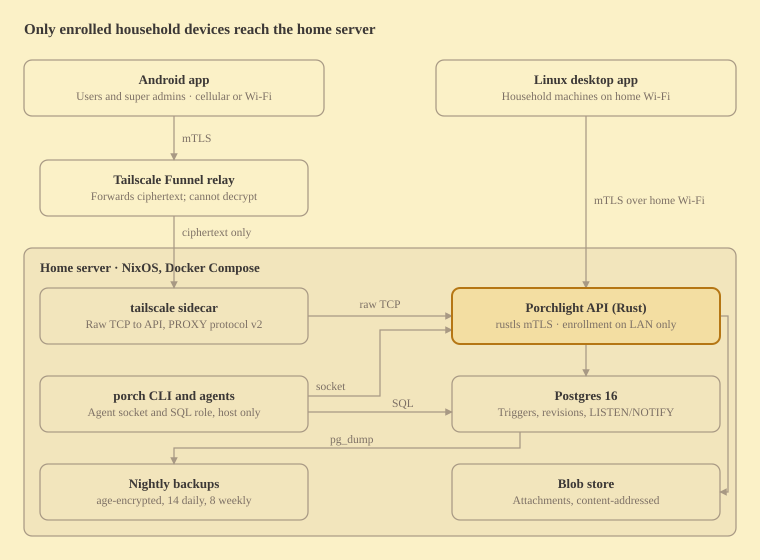

# Porchlight — Design Spec

Oct 4, 2026

## Overview

Porchlight is a self-hosted task, chore, list and calendar system for one household of 3–10 people. It runs on the household's NixOS home server, and no third party can read its data, including the network relay.

**Roles.** Super admins run the server, have full control and are the only agent users. Users have accounts and enrolled devices, mostly on mobile. Dependents are profiles with no account or device; users and super admins coordinate their appointments weekly.

**Goals**

- Shared tasks, appointments, chores and lists with delegation, ownership and private items.
- Per-person conflict detection and scheduling suggestions.
- Android and Linux desktop clients with feature parity and one shared cozy theme.
- One-command install, automatic backups, and an internet footprint that rejects every unenrolled device at the TLS handshake.
- Full agent access for super admins through a CLI and direct SQL.

**Non-goals for v1:** a web app, iOS, offline editing, two-way calendar sync, Proton subscriptions, public sign-up, third-party login, biometrics, and native distro packaging.

## Decision log

Every decision below is locked for v1; changes go through this table. Rows marked *(Oct 5)* were amended during implementation planning; the reasoning and alternatives are in `docs/plans/2026-10-05-master-plan.md`.

| Area | Decision | Why |
| --- | --- | --- |
| Tenancy | One household per install; `household_id` on every domain row | Cheap now, avoids a retrofit later |
| Backend | Rust (axum, sqlx, tokio), Postgres 18 | Compile-checked SQL, small footprint; native `uuidv7()` defaults so raw agent INSERTs work *(Oct 5)* |
| Clients | Kotlin Multiplatform: Android + Compose Desktop (Linux) | One codebase, one theme, parity by construction |
| Web app | Dropped | Browsers block mTLS-everywhere and add web attack classes |
| Reachability | Tailscale Funnel, raw TCP to the API | No inbound ports, relay sees only ciphertext, no client installs |
| Transport auth | Private CA + mTLS on every client connection; revoked device certificates also fail at the handshake; TLS session resumption off | Unenrolled and revoked devices fail at the handshake *(Oct 5)* |
| User auth | Password per account; device PIN gate on Android; cert + password on desktop | Intuitive for users, cert stays the primary factor |
| Biometrics | None | No household member uses them |
| Offline | Online-only writes, read cache | Consistency over offline editing |
| Notifications | Local alarms for time-based; own foreground service + SSE for events; WorkManager polling as safety net | No Google, no second public endpoint |
| Agents | Super admins only, full visibility, CLI + direct SQL | Super admins run the server |
| Calendar | ICS import + server-pulled read-only feeds; no Proton subscription | Simple, no inbound dependency |
| Time | Floating times supported; household default America/New_York | Meds at 8 AM wherever you are |
| Recurrence | Per-task: calendar or completion-based, with a missed-occurrence policy | Chores differ |
| Kanban | Fixed statuses: Backlog, To Do, Doing, Done | Simple, predictable |
| Location | Plain copyable address text | Everyone uses different maps apps |
| Comments, attachments | In v1 | School flyers and prescription photos are core use cases |
| Storage | Disk-heavy: materialize derived data, keep full revisions | Disk is cheap, RAM is not |
| Writes | Idempotency key required on every mutation | Mobile retries must never duplicate |
| Versioning | Client version header; server answers 426 below the minimum | Clients update independently |
| Distribution | Signed releases published on GitHub Releases; the household server relays the matching APK and desktop files to its own devices over mTLS, and devices never contact GitHub. `install.sh` verifies a minisign-signed manifest from GitHub, a local directory or SSH; jpackage app image with bundled JRE | A super admin maintains every install; one public source of truth, devices keep a single household-pinned HTTP stack *(Oct 10)* |
| Backups | Automatic on the server, passive copy pulled by a super admin's desktop; every bundle independently restorable, blobs included; recovery private key never on the server | Zero manual steps; a bundle alone restores everything *(Oct 5)* |
| Client cache | 180-day cleanup | Bounded local storage |
| Derivation | API and `porch` writes derive occurrences, agendas, reminders and conflicts in Rust inside the request transaction; raw agent SQL writes are derived asynchronously by an API worker fed by trigger-enqueued jobs | One recurrence engine (`rrule` crate); raw SQL is eventually consistent, typically within seconds *(Oct 5)* |
| Live stream | Transactional outbox; a single projector assigns a commit-ordered `stream_seq`, which is the SSE event ID | UUIDv7 IDs are not commit-ordered and coalesced notifications mutate *(Oct 5)* |
| Versioning (rows) | Triggers always bump `version`; writers detect staleness with `WHERE version = expected` | One rule for API, CLI and raw SQL *(Oct 5)* |
| Development | Laptop first, home server last; git with a public GitHub repository (the release source), plus source snapshots for rollback and parallel work; Android emulators until final testing | Owner's workflow *(Oct 5, git Oct 9)* |
| Desktop target | Any Linux desktop, independent of init system and desktop environment (niri autostart supported); tray via StatusNotifierItem over D-Bus; no systemd units | Desktop-agnostic by design *(Oct 5)* |
| Name | Porchlight | Warm, cozy, someone's looking out for you |

## Architecture

Porchlight is three containers on the home NixOS server (Postgres, the Rust API and a Tailscale sidecar) plus native clients that reach the API only over mTLS.



Phones connect from anywhere through the Funnel relay, which never sees plaintext; desktops at home connect over the LAN. A super admin's desktop also pulls each night's encrypted backup bundle over the same mTLS connection.

The disk-heavy design keeps memory modest: Postgres runs with 512 MB of `shared_buffers`, and the API is a single static binary in a distroless image.

## Network and transport security

The only public entry is a Tailscale Funnel raw-TCP forward to the API's mTLS listener. Any client without a household device certificate fails during the TLS handshake and never sees an HTTP response.

**Funnel.** A `tailscale/tailscale` sidecar forwards public port 443 as raw TCP to the API's Funnel listener on port 9443 (`--tcp`), with PROXY protocol v2 so the API sees real client addresses. Connections are outbound only: no router ports, home IP never exposed, CGNAT irrelevant. The relay forwards ciphertext it cannot decrypt.

**Tailscale node hygiene**

- Register the server as a tagged node (`tag:porchlight`) so key expiry is disabled; the installer checks and warns loudly.
- Use a neutral machine name (for example `node-7f3a`) and a randomized tailnet name, since hostnames can surface in Certificate Transparency logs.

**Private PKI.** `porchlight init` generates a household CA at install time (`rcgen`). The API terminates TLS 1.3 itself with `rustls` and a client-certificate verifier rooted in that CA; there is no Caddy.

| Certificate | Lifetime | Renewal |
| --- | --- | --- |
| Household root CA | 10 years | Manual, documented |
| Server certificate (ts.net name + LAN name and IP) | 2 years | Automatic at startup when under 60 days |
| Device client certificate | 1 year | Client renews over mTLS when under 30 days |

Clients pin the household CA, whose fingerprint arrives in the enrollment URI. In raw TCP mode the server can present its private-CA certificate on the ts.net name, so no publicly trusted certificate should be needed. Verify on crt.sh after first setup.

**Listeners**

| Listener | Binds to | Authentication | Reachable from |
| --- | --- | --- | --- |
| API (LAN) | LAN interface, port 8443 | Client cert + session | LAN |
| API (Funnel) | Ingress Docker network only, port 9443; PROXY v2 header required, accepted only from the sidecar's address | Client cert + session | Internet via Funnel |
| Enrollment | LAN interface, port 8444; presents the full chain including the root | One-time token; client checks server CA fingerprint | LAN only |
| Agent / CLI | Unix socket `/run/porchlight/agent.sock` | Personal access token | Server host only |
| Postgres | Docker network + `127.0.0.1:5432` | Role password | Server host only |

**Defense in depth.** Even behind mTLS, the API rate-limits logins and writes per device and per client address. Accounts lock out with exponential backoff after 5 failed passwords.

## Identity, authentication and devices

Every request needs a valid household device certificate and a live session for the user that device belongs to. The certificate is the primary factor; the password proves the person.

**Passwords.** Hashed with Argon2id at m = 64 MiB, t = 3, p = 4. Minimum 12 characters, checked against an offline breached-password list compiled into the binary. No third-party password service.

**Sessions.** Opaque 256-bit tokens, stored as SHA-256 hashes in `sessions` and bound to one device. A request whose certificate and session belong to different devices is rejected. Sessions are obtained with `POST /v1/auth/login`, which requires an enrolled device certificate but no session; `POST /v1/auth/reset-password` works the same way.

| Platform | Daily unlock | Password asked | Session lifetime |
| --- | --- | --- | --- |
| Android | Device PIN via device-credential prompt, no fallback | At enrollment, sensitive actions, after expiry | 180 days sliding |
| Linux desktop | Linux login; client key unlocked from Secret Service, or an owner-only key file when no Secret Service provider exists | At enrollment, sensitive actions, after expiry | 90 days sliding |

**Sensitive actions** require re-entering the password: revoking devices, super admin operations, bulk deletes and purges.

**Password reset.** No email exists, so a super admin runs `porch user reset-password <user>`. That issues a one-time code, valid 15 minutes, usable only from an already enrolled device.

**Shared desktops.** Each person gets their own Linux account, since the client key lives in that account's Secret Service keyring or, without a provider, in an owner-only key file in that account's data directory. Which of the two holds a device's key is recorded at enrollment and never changes silently; switching means re-enrolling.

### Device enrollment

1. A super admin runs `porch enroll --user <name> --device <label>` on the server (or from a super admin's desktop).
2. The server prints an enrollment URI and a terminal QR code: `porchlight://enroll?host=<lan-ip>&token=<one-time>&ca=sha256:<fingerprint>`. The token expires in 15 minutes.
3. The device connects to the LAN-only enrollment listener and checks the CA fingerprint (SHA-256 of the CA certificate's DER) before sending anything secret.
4. It generates its key pair locally (Android Keystore on phones, an encrypted PKCS#12 file on desktop) and sends a certificate signing request, the token and the user's password.
5. The server returns a client certificate and the first session. The private key never leaves the device.

Because enrollment is LAN-only, adding a device requires being home; a leaked token is useless from outside.

**Revocation** sets `devices.revoked_at`; the TLS verifier rejects every certificate ever issued to that device, every request checks it, and open streams are closed, so it takes effect immediately. Lost phones are revoked from any super admin's device or the CLI.

## Permissions and visibility

Access combines a household role, a per-item relationship and the item's visibility. Every path that exposes item data enforces all three.

**Household roles:** `super_admin` (full control, server operations, the only agent users), `user` (an account with enrolled devices) and `dependent` (a profile with no account or device).

**Item relationships:** `owner` (the creator unless transferred), `assignee` (one or more, responsible), `subject` (who it is about, often a dependent) and `viewer` (explicit access when visibility is `selected`).

**Visibility:** `household` (all members), `private` (owner and assignees only) or `selected` (owner, assignees and listed viewers).

| Action | Owner | Assignee | Other user who can see it | Super admin |
| --- | --- | --- | --- | --- |
| View, comment | Yes | Yes | Yes | Yes, if visible |
| Change status, complete, snooze | Yes | Yes | No | Yes |
| Edit details, reminders | Yes | No | No | Yes |
| Reassign, change visibility | Yes | No | No | Yes |
| Take an unassigned dependent item | Yes | Yes | Yes | Yes |
| Delete (soft) | Yes | No | No | Yes |

Super admins in the app follow visibility like everyone else, so a private surprise stays private even from a super admin's phone.

**Derived data rule.** Derived data never authorizes access. Every read of `member_agenda`, `scheduled_reminders`, notifications and their payloads, `item_revisions`, search, SSE events and conflict messages joins the item's authoritative visibility (owner, assignees, viewers and `visibility`) at query time, so a raw SQL change that is still awaiting derivation can never widen access. Any change that can remove someone's access (visibility, owner transfer, removed assignee or viewer) emits an access-changed event so their devices evict what they cached. A conflict with an item you cannot see shows as "Busy".

**Agent exception.** Agent tokens and the agent SQL role belong to super admins and see everything. Every agent write is attributed and audited (see Agents and CLI).

## Data model

Postgres is the system of record and enforces its own invariants with triggers. That way writes from the API, the CLI and raw agent SQL all stay consistent, audited and live.

**Conventions:** UUIDv7 primary keys (`DEFAULT uuidv7()`), `timestamptz` everywhere, `household_id` on every domain row, soft delete via `deleted_at`, and an integer `version` on every mutable row for optimistic concurrency.

**Disk-heavy principle.** Anything costly to derive at read time is materialized: occurrences, reminder firing times, per-member agendas, full revision snapshots, generated columns.

```sql
items(id, household_id, title, notes, priority, owner_id, subject_member_id NULL,
      kind,               -- todo | deadline | appointment
      time_mode,          -- fixed: instants + tzid | floating: local wall-clock anchors
      due_date date NULL, due_at timestamptz NULL, starts_at timestamptz NULL, ends_at timestamptz NULL,
      local_due timestamp NULL, local_start timestamp NULL, local_end timestamp NULL,
      all_day bool, tzid text NULL, address text NULL,
      buffer_before_min int, buffer_after_min int, est_minutes int NULL,
      rrule text NULL, recurrence_mode, completion_interval interval NULL, missed_policy, visibility,
      source text NULL, version int, created_at, updated_at, deleted_at)

item_occurrences(id, item_id, seq,
      local_start, local_end, local_due, due_date,           -- generated anchors
      starts_at, ends_at, due_at,                            -- generated, resolved in the item's zone
      override_local_start, override_local_end, override_local_due, override_due_date,  -- "this occurrence" edits
      is_detached bool GENERATED (any override set),
      status, board_position, completed_by, completed_at,    -- authoritative Kanban state
      disposition,                                            -- generated: open | overdue | expired (missed policy)
      version,
      during tstzrange GENERATED (NULL when untimed, else tstzrange(starts_at, ends_at)))

member_agenda(member_id, occurrence_id, item_id, starts_at, ends_at, due_at, due_date,
      busy tstzrange)     -- resolved in the member's zone and widened by travel buffers
```

| Table | Holds |
| --- | --- |
| `households`, `users`, `household_members` | Household, login accounts, member profiles (dependents have no user) and each member's authoritative time zone |
| `user_credentials` | Password hashes, kept apart so agent grants never reach them |
| `devices`, `device_certificates`, `sessions`, `enrollment_tokens`, `password_resets` | Devices, every certificate issued to them, sessions, one-time codes |
| `api_tokens` | Agent personal access tokens (hashed, scoped, expiring) |
| `items`, `item_assignees`, `item_viewers` | Item definitions and relationships |
| `item_occurrences` | Concrete instances: generated anchors and times, "this occurrence" overrides, Kanban status and order |
| `item_revisions` | Full JSONB snapshot per write, with actor and `application_name` |
| `task_events` | Append-only activity feed |
| `item_reminders`, `notification_prefs` | Per-item reminder offsets, per-member settings |
| `scheduled_reminders` | Materialized firing times per member |
| `member_agenda` | Per-member resolved times and buffered busy ranges; home screens and conflict checks read these |
| `availability_windows`, `schedule_suggestions` | Scheduler inputs and proposals |
| `lists`, `list_entries`, `list_entry_checks` | Lists and check state |
| `comments`, `attachments`, `blobs` | Discussion and files |
| `notifications` | In-app inbox |
| `outbox` | Transactional change events; the projector assigns `stream_seq` for SSE |
| `item_derivation` | Per-item derivation generations; pending while `applied_gen < requested_gen` (e.g. after a raw SQL write) |
| `member_settings` | One versioned JSONB settings document per member |
| `idempotency_keys` | Replay protection for writes |
| `ics_sources`, `ics_uid_map` | Calendar feeds and import identity |

**Triggers** (every write, whatever its origin):

- Bump `version` and `updated_at`; writers detect stale versions with `WHERE version = <expected>`.
- Insert the `item_revisions` snapshot and the `task_events` row, attributed to the actor.
- Enqueue a derivation job when timing, the RRULE, relationships or reminders change.
- Write business `notifications` (assignment, status, comments, agent changes) according to the routing rules.
- Insert an `outbox` row and `pg_notify` to drive live SSE updates.

**Derivation** (Rust, `porchlight-core`) regenerates future, non-detached occurrences, per-member `member_agenda` rows, `scheduled_reminders` and conflicts. API and CLI writes run it inside their own transaction and return conflicts synchronously; jobs left by raw SQL writes are drained by a worker in the API, typically within seconds. Visibility is always read from authoritative tables, never from derived rows. The full input/output map is `docs/specs/derivation-matrix.md`.

Hard deletes happen only through a super admin purge command.

## Time, recurrence, conflicts and scheduling

Every item carries a time mode, and recurring items carry a per-task recurrence mode and missed-occurrence policy. Conflicts warn and never block.

### Time

- **Item kinds:** `todo` (optional `due_date`), `deadline` (`due_at`), `appointment` (`starts_at`, `ends_at`, optional all-day).
- **`fixed`:** an instant plus an IANA `tzid` ("dentist 2 PM Eastern").
- **`floating`:** a wall-clock time evaluated in the member's current zone ("meds at 8 AM wherever I am").
- **Defaults:** household zone America/New_York. Clients send their device zone with every request (`Porchlight-TZ`). Each member has one authoritative zone (`household_members.tzid`), set by their zone-authority device or manually; floating reminders are recomputed when it changes. Dependents use the household zone.

### Recurrence

- **Rules:** an RFC 5545 RRULE subset (FREQ daily, weekly, monthly or yearly; INTERVAL, BYDAY, BYMONTHDAY, COUNT, UNTIL), expanded with the `rrule` crate.
- **`recurrence_mode`, per task:** `calendar` materializes occurrences 18 months ahead, extended nightly. `completion` keeps exactly one open occurrence; completing it creates the next at completion time + interval.
- **`missed_policy`, per task:** `carry_over` (one overdue instance persists until done), `skip` (missed instances expire) or `stack` (every missed instance stays open).
- **Edits:** "this occurrence" (sets `is_detached`), "this and future" (splits the series) or "all". Regeneration never touches detached or completed occurrences.

### Kanban

Fixed statuses: Backlog, To Do, Doing, Done. A recurring series shows only its next open occurrence on the board. Done cards are hidden from the board after 7 days by query; nothing is archived or deleted.

Board filter chips update the selected chip and projection in place on desktop and Android: Household shows all visible cards; Mine shows cards where the signed-in member is the owner, subject or an assignee; a member chip applies the same rule to that member. Member filters use the server's household projection and filter locally; the server remains authoritative for visibility and occurrence selection. Switching main tabs preserves the last Board filter.

### Conflicts

- **Hard conflict:** overlapping buffered `busy` ranges in `member_agenda` for the same member, found with a GiST index on `(member_id, busy)` and the `&&` operator. Floating items are resolved in each member's own zone.
- **Load conflict:** a day's summed `est_minutes` exceeds that member's availability.
- Both return as warnings in the write response and notify the affected person. Imported busy blocks count as appointments.

### Scheduling suggestions

- **Inputs:** `availability_windows` (member, weekday, start, end), existing occurrences plus buffers, `est_minutes`, deadline, priority.
- **Algorithm:** greedy Earliest Deadline First places each unscheduled task in the earliest free window that fits before its deadline.
- **Output:** rows in `schedule_suggestions` (proposed, accepted, dismissed). Accepting one sets the occurrence's start and end. Nothing moves automatically.
- **Runs:** nightly, and on demand from the app or CLI.
- **Dependent items:** the scheduler can suggest which user or super admin has room for an unassigned dependent appointment.

Addresses are plain text with a copy button, so no maps integration is needed.

## Lists, comments and attachments

Lists, comments and attachments all ship in v1 and inherit the visibility of the item they belong to.

### Lists

```sql
lists(id, household_id, item_id NULL, name, mode, visibility)   -- mode: persistent | per_occurrence
list_entries(id, list_id, label, qty, unit, url NULL, notes, position text, archived_at)
list_entry_checks(entry_id, occurrence_id NULL, checked_by, checked_at)
```

- **`persistent`** (groceries): standalone, `item_id` null. Checked entries move to a "Got it" section until someone clears them.
- **`per_occurrence`** (meds reorder): attached to a recurring item. Checks are keyed by occurrence, so each instance starts fresh while the entries carry over.
- **`url`** holds a product link for one-tap reordering.
- **Ordering** uses fractional-index string keys (`fractional_index` crate): a drag updates one row. Kanban card order uses the same scheme.

### Comments

- Plain text with @mentions of members; mentions notify.
- Editable by the author for 15 minutes, soft-deletable by the author or a super admin.
- Each comment notifies the item's owner and assignees, minus the author.

### Attachments

- **Storage:** content-addressed files on the data volume at `/data/blobs/<aa>/<bb>/<sha256>`, deduplicated by hash. `attachments` links blobs to items or comments.
- **Limits:** 25 MB per file; images, PDFs and plain text only.
- **Privacy:** EXIF metadata, including GPS location, is stripped from images on upload.
- **Thumbnails:** generated server-side and stored as their own blobs.
- **Access:** downloads go through the mTLS API with the same visibility checks; clients cache recently viewed files under the 180-day cleanup.
- **Cleanup:** blobs with no references for 30 days are garbage-collected.

## Notifications

Time-based alerts are scheduled locally on each device from synced data. Event alerts flow over the app's own mTLS SSE stream, with a WorkManager poll as a safety net. Nothing touches Google.

### Server side

- **Source of truth:** `notifications` rows. Business notifications (assignment, status, comments, agent changes) are written from each write's own event, with its actor; conflict and reminder notifications are written by derivation, deduplicated per occurrence, member and kind. The in-app inbox reads them with authoritative visibility.
- **Tickle payloads:** the stream carries IDs and categories only; clients fetch details over mTLS.
- **Coalescing:** events for one recipient within 30 seconds merge into one summary ("A user updated 6 items").
- **Quiet hours:** event notifications wait and release as a morning batch; time-based reminders still fire.
- **Reminders:** `scheduled_reminders` holds exact firing times per member, recomputed by derivation.

| Event | Who is notified |
| --- | --- |
| Assigned to you | The assignee, unless self-assigned |
| Status changed or completed | The owner |
| Comment or @mention | Owner and assignees, mentioned members |
| Conflict created | The member whose calendar now conflicts |
| Unassigned dependent appointment | All users and super admins: Sunday 6 PM, then 48 h and 24 h before |
| Agent change | Same rules, labeled with the agent's name |

### Android: time-based

- **Permissions:** `USE_EXACT_ALARM` (sideloaded calendar app) and `POST_NOTIFICATIONS`, requested at onboarding.
- **Scheduling:** `setExactAndAllowWhileIdle`, reconciled after every fetch against a rolling 7-day window (well under the per-app pending-alarm cap). A daily WorkManager job extends the window.
- **Request codes:** from a local auto-increment table, never hashed UUIDs.
- **Rescheduling** from the read cache on `BOOT_COMPLETED`, `MY_PACKAGE_REPLACED`, `TIME_SET` and `TIMEZONE_CHANGED`.
- **Channels:** Reminders, Assignments, Dependents' appointments, Household activity, Digest, Connection (the service icon).
- **Lock screen:** notifications are private, with a public version reading "Porchlight: 1 reminder".
- **Actions:** Done, Snooze 15 min, Got it, Take it. Taps run an expedited WorkManager job against the API. Snooze is local and always works; failures update the notification with a retry.

### Android: event-driven

- **Foreground service** of type `specialUse` holds the SSE stream (`dataSync` is capped at 6 hours a day on Android 15+). Its notification sits on a minimum-importance channel.
- **Battery:** the app requests a battery-optimization exemption at onboarding; check dontkillmyapp.com for each enrolled phone.
- **Heartbeat:** the server sends an SSE comment every 120 s; two missed heartbeats mean reconnect.
- **Reconnect:** exponential backoff with jitter, plus an immediate retry on network change (`ConnectivityManager.NetworkCallback`).
- **Resumption:** event IDs are the commit-ordered `stream_seq`; reconnects send `Last-Event-ID` and the server replays everything newer, or asks for a fresh snapshot if the cursor has expired.
- **Safety net:** a 15-minute periodic WorkManager job fetches unread notifications and reconciles alarms.

### Desktop

The app autostarts minimized to the tray, holds the same SSE stream and schedules local reminder timers. Notifications with action buttons go through the freedesktop notification service over D-Bus (`dbus-java`).

### Cross-device dismissal

Marking a notification read on one device sets `read_at` and emits `notification.dismissed`; the member's other devices cancel it.

## API contract

The API is versioned REST plus JSON under `/v1`, described by an OpenAPI spec generated from the Rust handlers with `utoipa`. The Kotlin client is generated from that spec, so the spec is the single contract.

### Request headers

| Header | Required on | Purpose |
| --- | --- | --- |
| `Authorization: Bearer <session>` | All except enrollment, `POST /v1/auth/login` and `POST /v1/auth/reset-password` | Session, checked against the certificate's device (agents authenticate with a PAT on the agent socket instead) |
| `Idempotency-Key` | Every non-GET | Replay protection |
| `Porchlight-Client-Version` | All | Version gate |
| `Porchlight-TZ` | All | Device zone for floating times |
| `If-Match: <version>` | Updates and deletes | Optimistic concurrency |

### Idempotency

- A write without `Idempotency-Key` is rejected with 400.
- Keys are scoped to the caller (device, PAT, or enrollment token for enrollment requests) and stored in `idempotency_keys` with the request hash and full response, kept 24 hours.
- The same key with the same body returns the stored response; with a different body it returns 422.
- Concurrent requests with one key: the second waits for the first, then gets its stored response.
- Notification action buttons reuse a key derived from the notification ID plus the action.

### Concurrency and errors

- A stale `If-Match` returns 409 with the current resource, so the client can show what changed.
- Errors use `application/problem+json` (RFC 9457) with a stable `type` per error.
- Writes that create conflicts succeed and return a `conflicts` array.

### Versioning

The server holds a `min_client_version`. Older clients get `426 Upgrade Required` with that version, and the apps show an update screen with an Update button. The update endpoints (`/v1/client-release`, `/v1/client-release/files/…`) are exempt from the minimum, so a too-old app can still fetch its update. Devices update to the version the server runs, never past it. Within `/v1`, changes are additive only.

### Reads and live updates

- **`GET /v1/snapshot`:** everything the member can see within the cache window; this fills the read cache.
- **`GET /v1/agenda?from&to`:** reads `member_agenda` joined with authoritative visibility, with pending-derivation flags.
- Collections use cursor pagination.
- **`GET /v1/stream`:** Server-Sent Events fed by Postgres `LISTEN/NOTIFY`, with event types for item, occurrence, list, comment, notification and `notification.dismissed` changes, 120 s heartbeats and `Last-Event-ID` replay by `stream_seq`. `/v1/snapshot` returns the matching cursor from the same database snapshot.

## Clients

One Kotlin Multiplatform project builds the Android app and the Linux desktop app. Models, the API client, repositories, view models, the theme and most screens live in shared code.

```
client/
├── shared/
│   ├── commonMain/   # models, generated API client, repositories, view models, theme, screens
│   ├── androidMain/  # Keystore, device-credential gate, alarms, foreground service, channels
│   └── jvmMain/      # Secret Service / owner-only file keys, tray, D-Bus notifications, autostart, local timers
├── androidApp/       # Activity, manifest, QR enrollment scanner
└── desktopApp/       # main(), window, tray icon, URI-paste enrollment
```

| Concern | Choice |
| --- | --- |
| UI | Compose Multiplatform, Material 3 adaptive layouts (stacked on phone, multi-pane on desktop) |
| Navigation, view models | JetBrains multiplatform Navigation Compose and `lifecycle-viewmodel` |
| HTTP | Ktor with the OkHttp engine on both platforms; shared mTLS and CA pinning |
| API client | `openapi-generator` Kotlin multiplatform output (Ktor + kotlinx.serialization) |
| Live updates | Ktor SSE plugin |
| Read cache | SQLDelight; entries older than 180 days are purged |
| Key storage | Android Keystore; desktop PKCS#12 encrypted with a secret in Secret Service (`java-keyring`, any provider, standard Unlock prompt), or in an owner-only file (0600 in a 0700 folder) when no Secret Service provider exists or, by the user's explicit choice at enrollment, when one is present but unusable; backend recorded at enrollment |

### Android

- **SDK:** minSdk 30 (device-credential-only prompt), targetSdk 35.
- **App gate:** opening the app requires the device PIN through `BiometricPrompt` with the `DEVICE_CREDENTIAL` authenticator only. No fallback.
- **Distribution:** sideloaded APK (first install from the GitHub release or `adb`). Updates come from the household server: the app checks the download's SHA-256, that the APK is `app.porchlight`, newer, and signed by the same certificate as the running app, and only then hands it to `PackageInstaller` (one system confirmation).
- **Notifications and permissions:** see Notifications.

### Desktop

- **Packaging:** jpackage app image with a bundled JRE (about 80–120 MB), insulated from distro JDK updates (household desktops may run any distribution, init system or compositor).
- **Startup:** autostarts minimized to the tray and holds the SSE stream. The tray is a StatusNotifierItem over D-Bus; autostart is an XDG autostart entry plus a niri `spawn-at-startup` line, with no systemd units.
- **Wayland:** runs via XWayland; tune `sun.java2d.uiScale` in the launcher if fractional scaling looks soft.
- **Super admin extras:** A super admin's desktop shows device management, enrollment, and the passive backup pull.

### App state and settings

Both apps reopen on the screen the person last left, and a Settings menu lets each person tune their colors and what appears on Today.

**Resume where you left off**

- **What is saved:** the current screen plus its context (open item, board filter, calendar view and date, selected list), written locally on every navigation change.
- **Where:** Jetpack DataStore (multiplatform) on both platforms, a file in app storage on Android and in `~/.local/share/porchlight` on desktop. Android also uses `rememberSaveable` to survive process death.
- **Scope:** per device, never synced; a phone and a desktop each remember their own place.
- **Fallback:** first launch, or a saved item that was deleted or is no longer visible, opens Today.
- **Order on launch:** the Android PIN gate runs first, then the restored screen appears.

**Settings menu**

Back from a Settings section returns to the Settings list; Back from the list returns to the previous screen. This applies to the in-app Back control and Android system/predictive back. A resumed or directly opened section also has the list as its parent. Selecting a main tab leaves Settings.

| Group | Settings | Stored |
| --- | --- | --- |
| Appearance | Theme (Evening, Daylight, follow system), member color | Theme per device; member color on the server |
| Today | Which sections show and their order (Overdue, Today, This week, Needs an owner, a pinned list), mine only or whole household, how many days "This week" covers | Server, so every device matches |
| Start screen | Last screen (default) or a fixed screen | Per device |
| Notifications | Per-category toggles, quiet hours, default reminder times | Server (`notification_prefs`) |
| Account and devices | Change password, see and revoke your own devices | Server |

Today and start-screen settings live in a `member_settings` table (one JSONB document per member, versioned like other rows); notification settings live in `notification_prefs`. Both sync to the member's devices over the SSE stream.

## Agents and CLI

Super admin's agents get two channels, both limited to the server host and both with full visibility: the `porch` CLI over a Unix socket, and direct SQL through a dedicated Postgres role.

### `porch` CLI

- Built from the server's Cargo workspace, so it shares types with the API.
- Talks to the agent listener at `/run/porchlight/agent.sock` with a personal access token (`PORCHLIGHT_TOKEN`).
- JSON output with `--json` for agents.
- Covers items, occurrences, lists, imports, enrollment, users, devices, backups and purges.
- Goes through the full business logic: permissions, conflict warnings, notifications.

```
porch items add --title "Dentist" --start 2026-10-12T14:00 --tz America/New_York \
  --subject dependent-1 --assign user-1 --buffer-before 20 --json
porch lists add-entry groceries "Oat milk" --qty 2
porch import ics ~/Downloads/school.ics --member dependent-1
```

### Personal access tokens

Tokens are random 256-bit values stored hashed in `api_tokens`, each with a name, scopes and an expiry (default 1 year). They are created and revoked with `porch token create|revoke`.

### Direct SQL

- **Role:** `porchlight_agent` connects on `127.0.0.1:5432`.
- **Grants:** SELECT on domain tables; INSERT and UPDATE on items and settings; INSERT and DELETE on relationship rows (assignees, viewers, reminders), whose history lives in revisions; UPDATE on authoritative occurrence columns only. No other DELETE (soft delete via `deleted_at`), no DDL, and no access to credentials, sessions, devices, tokens or password resets.
- **Safety:** triggers enforce versioning, revisions, notifications and live updates for these writes too; occurrence regeneration, reminders and agendas follow asynchronously through the derivation worker (pending while `item_derivation.applied_gen < requested_gen`).
- **Attribution:** agents set `application_name = 'agent:<name>'`, recorded in every revision and shown in the app as the actor.
- **Undo:** any agent change can be reverted from its `item_revisions` snapshot (`porch revert <item> --to <rev>`).

## ICS import and data export

Calendars come in through one-off ICS imports or server-pulled read-only feeds. Data goes out as a full JSON-plus-ICS export.

### Import

- **Entry points:** an app upload or `porch import ics <file> --member <who>`.
- **Parsing:** the `icalendar` crate, including VTIMEZONE, RRULE, EXDATE and all-day events.
- **Identity:** `ics_uid_map` maps each event UID (plus RECURRENCE-ID for overrides) to an item, so re-importing updates instead of duplicating.
- **Marking:** imported items carry `source = 'ics:<name>'` and show a badge.
- **Loss reporting:** retained-series exceptions override timing/status, not title/notes/location; differing details retain the master values and emit informational `UnsupportedOverrideDetails` on every apply (not partial or a daily feed_error, per R68). Expanded standalone exceptions retain their own details.
- **Bounded apply (R76, R67 counting):** imports/feeds admit up to 4 000 measured actual-work units: unchanged events cost one; new/changed events charge projected plus existing rows, removed items charge 2 units plus existing rows (R80/M3 re-weighting). R12's 10 000 is only the parse/expansion cap. Rejection preserves previous state with `calendar-too-large` (422), or feed `last_error=calendar_too_large`. The fixed 20-second apply deadline returns unsealed retryable 409 on imports (bounded client retry); feeds back off as `retrying`/`apply_retryable` until three consecutive deadlines, whatever bytes were fetched (R80), escalate to `failed`/`apply_timeout` plus `feed_error`. A successful apply, 304, manual refresh or source PUT resets the streak; other failures neither advance nor reset it. Contention retries next poll without changing source state. UID identity is bounded to 1024 UTF-8 bytes. See the derivation matrix for measured sizing, counting and reset rules.

### Read-only feeds

- **Configuration:** `ics_sources` rows (name, URL, target member or household, refresh interval), managed in the super admin UI or the CLI.
- **Fetching:** nightly by default, over an outbound connection, which works fine behind Funnel. Example: a school district calendar. Expanded recurrence feeds fetch unconditionally to extend their rolling projection even when publisher content is unchanged.
- **Behavior:** feed items are read-only in the app and count as busy blocks for conflicts. Events removed from the feed are soft-deleted.

### Export

- **Member export:** everything that member can see, as JSON (all tables) plus one ICS file of their appointments.
- **Household export:** super admin only; everything, plus attachments, as a tarball.
- **Entry points:** an app download or `porch export --member <who>|--household`.

## Operations

One `install.sh`, pinned to a release version, handles every operational task. Backups run automatically on the server, and a super admin's desktop pulls a copy passively.

### install.sh modes

| Command | Runs on | Does |
| --- | --- | --- |
| `install.sh server` | Home server | Checks Docker, writes `.env` with random secrets, runs `porchlight init` (CA, server cert, migrations, first super admin, and the backup recipient whose private key was generated on a super admin's machine), asks for a Tailscale auth key, starts the stack |
| `install.sh desktop` | Household Linux machines | Copies and verifies the app image from a local or SSH artifact source (or the desktop subset the app downloads from the server), refuses downgrades, installs to `~/.local/share/porchlight`, adds launcher, icon, autostart and `porchlight-update` |
| `install.sh upgrade` | Home server | From `--source` or `--release <V|latest>` (GitHub, verified with the installed key; `<root>/porchlight-upgrade` wraps it): backup, plain pre-upgrade dump, load the verified images, migrate, restart, health check; any failure rolls back to the previous release automatically |
| `install.sh backup` | Home server | Immediate backup |
| `install.sh restore <bundle>` | Home server | Restores database, CA and secrets from a bundle |

**NixOS note.** The script cannot install Docker on NixOS. It detects NixOS and prints the snippet to add (`virtualisation.docker.enable = true;`) instead.

**Compose stack:** `postgres` (18, data on SSD), `api`, `tailscale`. All use `restart: unless-stopped`, healthchecks, and `depends_on: condition: service_healthy`.

### Backups

- **Nightly at 03:00 on the server:** `pg_dump -Fc`, the CA key, `.env`, a manifest and every referenced attachment blob, bundled and encrypted with `age` to the household recovery key. Each bundle restores on its own; missed runs catch up.
- **Recovery key:** generated on a super admin's machine, never stored on the server (only its public recipient is), and saved in a password manager or on paper. Without it, bundles cannot be decrypted, so a server compromise does not expose old backups.
- **Retention:** 14 daily and 8 weekly bundles in `/var/lib/porchlight/backups`.
- **Passive copy:** a super admin's desktop app pulls the newest bundle over mTLS each night into `~/.local/share/porchlight/backups`. No action needed.
- **Cold storage:** manual `rsync` of bundles and blobs to the HDD array whenever a super admin likes.
- **Signing keys:** the APK keystore and minisign key live on the super admin's dev machine and belong in their personal backups. Losing the APK key forces every phone to reinstall.

### Retention

| Data | Server | Client |
| --- | --- | --- |
| Items, occurrences, revisions, events | Kept; super admin purge only | Read cache, 180 days |
| Notifications | 90 days | 180 days |
| Idempotency keys | 24 hours | n/a |
| Expired sessions, tokens, enrollment codes | Purged nightly | n/a |
| Unreferenced blobs | 30 days | Cache, 180 days |
| Future occurrences | Rolling 18 months | 7-day alarm window |

### Releases

`scripts/release.sh` builds the server image, the signed APK and the desktop app image locally into `dist/`. Artifacts are signed with minisign, and `install.sh` embeds the public key and verifies every artifact. The public minisign key and the APK signer-certificate SHA-256 are committed in `deploy/release-keys/`; a release whose key or APK signer differs is refused. The owner publishes a clean, pushed build as GitHub Release `v<V>` with `scripts/publish-release.sh`, and the server's daily signed check tells super admins when a newer release exists.

### Health

The machine's own redundancy covers hardware. Clients show "Can't reach home since <time>" after 5 minutes without the stream, and super admin desktops raise a local notification after 30.

## Repository, testing and development

Everything lives in one git repository, published on GitHub (`scripts/snapshot.sh` also keeps read-only snapshots), and every change runs the local test suite, `scripts/ci.sh`.

```
porchlight/
├── server/            # Cargo workspace
│   ├── api/           # axum handlers, rustls mTLS, SSE, OpenAPI (utoipa)
│   ├── core/          # domain logic: recurrence, scheduler, permissions, notifications routing
│   ├── db/            # sqlx queries, migrations, SQL triggers and functions
│   └── cli/           # porch binary
├── client/            # Kotlin Multiplatform (see Clients)
├── deploy/            # docker-compose.yml, install.sh, Dockerfile (cargo-chef, distroless)
├── scripts/           # ci.sh, snapshot.sh, release.sh
├── var/               # local runtime state and secrets, never snapshotted
├── design/            # tokens.json, logo SVG, generated theme
└── docs/specs/        # this spec and successors
```

### Testing

- **Database:** `#[sqlx::test]` with an ephemeral database per test; trigger behavior tested in SQL directly.
- **Authorization matrix:** every endpoint × role × visibility × relationship, generated, including SSE events and notification payloads.
- **Recurrence and time:** `proptest` across DST transitions, floating vs fixed modes, and completion-based series.
- **Idempotency:** replays, mismatched bodies and concurrent duplicates.
- **mTLS:** handshake tests with valid, expired, revoked and foreign certificates.
- **Clients:** shared view-model tests in `commonTest`, Compose UI tests for enrollment, item creation, completion and lists.
- **Release pipeline:** `scripts/release.sh` builds and signs all artifacts.

### Development environment

- `porch dev-init` creates a development CA, server cert and client certs for the emulator and desktop.
- `docker compose -f deploy/compose.dev.yml up` runs Postgres and the API with the dev CA; the Android emulator reaches the host at `10.0.2.2`.
- There is no runtime flag to disable mTLS. Any test bypass is a compile-time feature excluded from release builds.
- `cargo sqlx prepare` keeps offline query metadata so Docker builds need no live database.

## Visual design and accessibility

Porchlight uses a warm, Gruvbox-adjacent palette in two themes: "Evening" (dark, by the fire) and "Daylight" (light, cabin). Both are generated from one `design/tokens.json` into a shared Compose `MaterialTheme`. The mockups use additional colors (for example `#32302F`, `#BDAE93`, `#FD8D7F`) that `tokens.json` adds, and the Daylight `onSurfaceMuted`, `primary` and `success` values below fail WCAG AA on light surfaces; they are corrected in `tokens.json` before the theme ships.

| Token | Evening | Daylight | Use |
| --- | --- | --- | --- |
| `background` | #282828 | #FBF1C7 | Window and screen background |
| `surface` | #3C3836 | #F2E5BC | Cards, sheets |
| `surfaceVariant` | #504945 | #EBDBB2 | Kanban columns, inputs |
| `onSurface` | #EBDBB2 | #3C3836 | Body text |
| `onSurfaceMuted` | #A89984 | #7C6F64 | Secondary text |
| `primary` (lamplight) | #FABD2F | #B57614 | Primary actions, focus, today marker |
| `secondary` (ember) | #FE8019 | #AF3A03 | Highlights, due-soon |
| `error` | #FB4934 | #9D0006 | Overdue, destructive actions |
| `success` | #B8BB26 | #79740E | Done |
| `info` | #83A598 | #076678 | Links, informational chips |

**Member colors** come from the Gruvbox accents (yellow, orange, aqua, blue, purple, green, red) and are assigned in order, editable per member. Color is never the only signal: every chip also shows initials or a name.

**Type and shape.** Literata (600) for headings and Source Sans 3 (400, 600, 700) for body text, as used in the mockups. All fonts are bundled in `composeResources` under the SIL Open Font License. Corners are 12 dp, with subtle paper or wood-grain textures on large surfaces only.

**Accessibility requirements**

- WCAG 2.2 AA contrast for all text and icons in both themes, checked by a CI test over `tokens.json`.
- Layouts respect the system font scale up to 200% without clipping.
- Every interactive element has a content description; touch targets are at least 48 dp.
- Theme follows the system setting, with a manual override.

**Process.** Claude Design produces screen designs and refines the tokens. A Gradle task generates the Kotlin theme from `tokens.json`, so design changes never need hand-edited code.

**App icon.** A cozy lantern in the Evening palette, `design/icon/porchlight-icon.svg`, exported to Android adaptive-icon layers and the desktop launcher PNG sizes (48, 64, 128, 256, 512 px).

## Build order, backlog and open questions

The build runs on the developer's laptop first and moves to the home server last; `docs/plans/2026-10-05-master-plan.md` breaks each milestone into tasks and gates.

### Build order

0. **Bootstrap:** source tree, local CI, snapshots, toolchains, these amendments.
1. **Foundation:** Compose stack, schema, migrations, roles and grants, core triggers (versioning, revisions, events, outbox), derivation job queue.
2. **Trust:** `porchlight init`, private CA, mTLS listeners, enrollment, passwords, sessions, devices, revocation, PATs, minimal stream.
2b. **Client transport probe:** throwaway Android (emulator) and desktop client proving enrollment, mTLS and background streaming.
3. **Items:** items, occurrences, recurrence modes, missed policies, derivation, conflicts, permissions, idempotency, versioning; `porch` CLI.
4. **Clients core:** KMP skeleton, theme from tokens, enrollment, PIN gate, agenda, Kanban, calendar, item editor, read cache.
5. **Live and notifications:** SSE stream, notifications routing, `scheduled_reminders`, alarms, foreground service, polling, desktop tray.
6. **Collaboration:** lists, comments, attachments.
7. **Calendar and planning:** ICS import and feeds, availability, load conflicts, scheduler suggestions, export.
8. **Ship (laptop):** release script and signing, `install.sh` modes, backups, restore drill, passive pull.
9. **Server and Funnel:** NixOS prerequisites, fresh production install on the home server, Tailscale Funnel sidecar, first physical-phone and cellular testing.

### Backlog (not v1)

- Bus-factor runbook and a second super admin.
- PKGBUILD, Flatpak or other native packaging.
- Dependent logins with a restricted role.
- UnifiedPush plus self-hosted ntfy as a fallback if the foreground service proves unreliable.
- Web app, iOS, two-way calendar sync.

### Open questions

- [ ] Confirm Funnel raw-TCP mode works with the private-CA server certificate, and check crt.sh for the hostname.
- [ ] Confirm the exact Funnel flags for raw TCP with PROXY protocol v2.
- [ ] Confirm a `specialUse` foreground service starts at boot on each enrolled phone, and note OEM battery settings per model.
- [x] Pick final fonts: Literata and Source Sans 3, as used in the mockups.
- [ ] Default availability windows for the super admin's work schedule.
- [ ] Is 25 MB per attachment enough for scanned PDFs?
